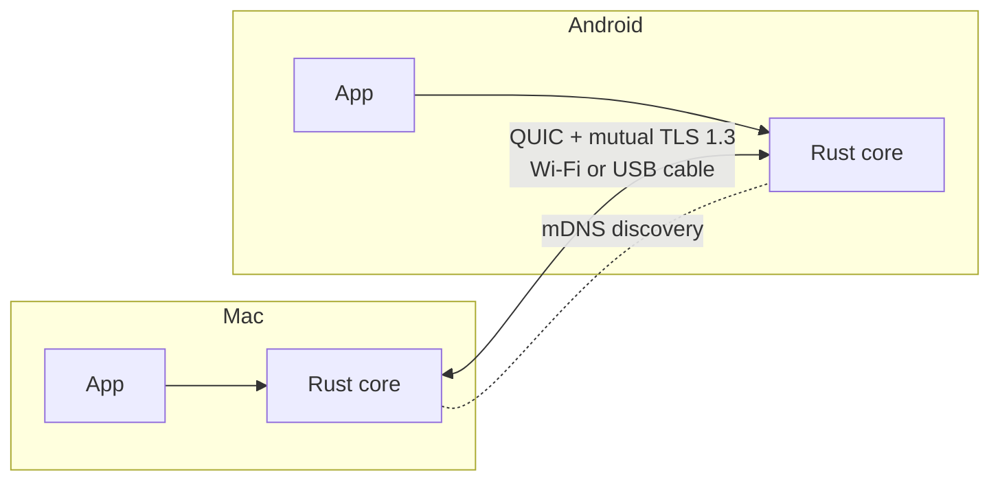

<div align="center">

# Ecosystem Connector

**Turn your Mac, Windows and Android devices into one ecosystem.**
Send anything instantly, keep files in sync without duplicates, share your clipboard,
and continue what you were doing on another device.

[](https://github.com/SerhanEnsar/ecosystem-connector/actions/workflows/core.yml)
[](https://github.com/SerhanEnsar/ecosystem-connector/actions/workflows/android.yml)
[](https://github.com/SerhanEnsar/ecosystem-connector/actions/workflows/macos.yml)
[](https://github.com/SerhanEnsar/ecosystem-connector/actions/workflows/windows.yml)
[](https://github.com/SerhanEnsar/ecosystem-connector/actions/workflows/security.yml)
[](LICENSE)


[Türkçe](README.tr.md) · [Architecture](docs/ARCHITECTURE.md) · [Contributing](CONTRIBUTING.md) · [Security](SECURITY.md)

</div>

> [!NOTE]
> The project is in **early development**. Nothing here is usable yet. Demos, screenshots
> and benchmark charts will be added as each feature lands, and every number shown will
> come from a reproducible benchmark in [`bench/`](bench/).

## Why

Working across a laptop, a phone and a tablet usually means sending the same file again
and again with separate tools. You edit a PDF on the computer, send it to the tablet,
edit again, send again, and soon every device holds a different copy.

Platform ecosystems solve this only inside their own walls. Ecosystem Connector does it
across platforms: Mac ↔ Android, Android ↔ Android, Windows ↔ Mac, Windows ↔ Android.

## Features (planned)

| Feature | What it does | Status |
|---|---|---|
| **Fast send** | Send any file or folder to a nearby device. Transfers resume after a drop and every chunk is verified. | Core done (CLI) |
| **Cable boost** | Plug in a USB-C cable (USB tethering or Thunderbolt bridge) and an active transfer starts using the faster path without restarting. | Core done, device test pending |
| **Linked files** | One file, one version on every device. Edit it anywhere and the others update within seconds. No duplicate copies. | Planned |
| **Shared clipboard** | Copy on one device, paste on another. Send the current browser tab. | Planned |
| **Handoff** | "Continue on this device?" for the file or web page open on your other device. | Planned |

## How it works



- **Local first.** Devices find each other on your network. There is no cloud server, and
  your data never leaves your devices.
- **Encrypted end to end.** Devices pair once with a QR code and a verification code.
  Every connection after that uses mutual TLS with pinned keys, and unpaired devices are
  refused.
- **Fast.** Files are split into chunks and sent over parallel QUIC streams. Each chunk is
  verified with BLAKE3, so an interrupted transfer only sends what is missing and an edited
  file only sends what changed.

Details are in [docs/ARCHITECTURE.md](docs/ARCHITECTURE.md), the wire format in
[docs/PROTOCOL.md](docs/PROTOCOL.md) and the security analysis in
[docs/THREAT_MODEL.md](docs/THREAT_MODEL.md).

## Roadmap

- [x] Phase 0: project skeleton, CI, security policy
- [x] Phase 1: device identity, pairing, discovery, encrypted connection
- [x] Phase 2: fast resumable transfer and cable boost, first benchmarks
- [ ] Phase 3: desktop and Android app v0
- [ ] Phase 4: linked files
- [ ] Phase 5: shared clipboard and browser extension
- [ ] Phase 6: handoff
- [ ] Phase 7: signed releases

## Install

Download the latest build from [Releases](https://github.com/SerhanEnsar/ecosystem-connector/releases):

| Platform | File |
|---|---|
| Android phone or tablet | `…-android-arm64-v8a.apk` (most devices) or `…-android-universal.apk` |
| macOS | `…-macos-universal.zip` |
| Windows | `…-windows-x64.zip` |
| Command line | `ec-cli-…` |

Early releases are marked as pre-releases. The apps only show their main screen until
phase 3 connects them to the core; the `ec` command line tool already works. Every file
can be checked with `gh attestation verify <file> -R SerhanEnsar/ecosystem-connector`.

## Try it: the `ec` command line tool

The apps are not ready yet, but the core already works from the command line. On two
computers in the same network (or two terminals on one, each with its own `--home`):

```sh
cargo install --path crates/ec-cli   # installs the `ec` command
```

```console
mac$ ec pair
█▀▀▀▀▀█ ▄▀█▄ ...   (QR code)
Scan the code, or run this on the other device:
  ec join 'ecpair:1?id=1abe79d4...&s=...&a=192.168.1.20:50112'

tablet$ ec join 'ecpair:1?id=1abe79d4...'
Serhan's Mac (1ABE-79D4) wants to pair.
Does the other device show the code 057 116? [y/N] y
Paired with Serhan's Mac (1ABE-79D4).

tablet$ ec serve
Galaxy Tab (9703-2A5D) is online on UDP port 50430. Press Ctrl-C to stop.

mac$ ec discover
9703-2A5D  Galaxy Tab               paired      192.168.1.31:50430

mac$ ec ping 9703
Connected to "Galaxy Tab" at 192.168.1.31:50430 (encrypted, identity verified).
  ping 1: 0.43 ms
```

Send files or whole folders. If the transfer is interrupted, sending again resumes it:

```console
mac$ ec send 9703 ~/Downloads/course
Resuming: 16.8 MB of 314.6 MB already on the other device.
  path: 192.168.1.31:54722
Sent 2 file(s), 297.8 MB in 2.0 s (150.7 MB/s over 2 path(s)).
```

A device that is not paired is refused during the TLS handshake:

```console
stranger$ ec ping 9703
Error: ... invalid peer certificate: ApplicationVerificationFailure
```

## Performance


Both ends on one machine (Apple M4) over loopback, with the full protocol: QUIC, TLS 1.3,
BLAKE3 verification and disk writes. This is the ceiling set by the software, about
2 Gbit/s per connection, which is well above what Wi-Fi 6 delivers in practice. Chunk
hashing runs at several GB/s and is not a bottleneck.

| Parallel streams | 1 | 2 | 4 | 8 | 16 |
|---|---|---|---|---|---|
| Median MB/s (5 runs) | 178 | 211 | 240 | 186 | 239 |

Wi-Fi and USB cable measurements between real devices will be added once the Android
app can send and receive (phase 3). Reproduce with `bench/README.md`.

## Building from source

Each platform has its own environment; see [docs/DEVELOPMENT.md](docs/DEVELOPMENT.md).

```sh
git clone https://github.com/SerhanEnsar/ecosystem-connector.git
cd ecosystem-connector

tools/check.sh core                  # Rust core: build, lint, test
flutter pub get                      # Flutter workspace (all apps)
cd apps/android && flutter run       # or apps/macos, apps/windows
```

## Repository layout

```
crates/      Rust core: identity, networking, transfer, sync, clipboard, handoff,
             and the `ec` command line tool
packages/    Shared Flutter UI (ec_ui)
apps/        One Flutter app per platform: android/, macos/, windows/
tools/       Local check script, release signing setup
extension/   Browser extension (planned)
bench/       Reproducible benchmarks that produce the charts in this README
docs/        Architecture, protocol, threat model, development guide
```

## Contributing

Contributions are welcome. Read [CONTRIBUTING.md](CONTRIBUTING.md) to get started. Report
security issues privately as described in [SECURITY.md](SECURITY.md), not in public issues.

## License

Licensed under the [Apache License, Version 2.0](LICENSE). Copyright 2026 SerhanEnsar.
