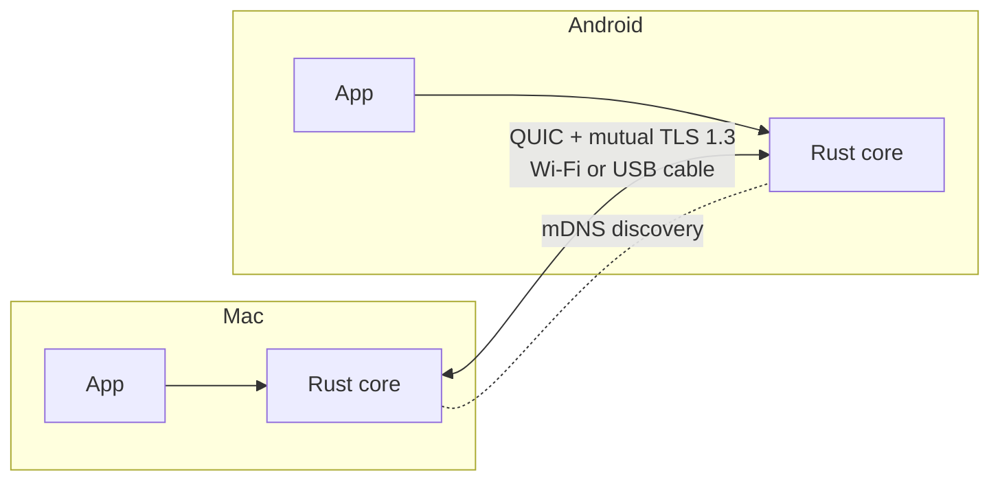

<div align="center">

# Ecosystem Connector

**Turn your Mac, Windows and Android devices into one ecosystem.**
Send anything instantly, keep files in sync without duplicates, share your clipboard,
and continue what you were doing on another device.

[](https://github.com/SerhanEnsar/ecosystem-connector/actions/workflows/ci.yml)
[](LICENSE)


[Türkçe](README.tr.md) · [Architecture](docs/ARCHITECTURE.md) · [Contributing](CONTRIBUTING.md) · [Security](SECURITY.md)

</div>

> [!NOTE]
> The project is in **early development**. Nothing here is usable yet. Demos, screenshots
> and benchmark charts will be added as each feature lands, and every number shown will
> come from a reproducible benchmark in [`bench/`](bench/).

## Why

Working across a laptop, a phone and a tablet usually means sending the same file again
and again with separate tools. You edit a PDF on the computer, send it to the tablet,
edit again, send again, and soon every device holds a different copy.

Platform ecosystems solve this only inside their own walls. Ecosystem Connector does it
across platforms: Mac ↔ Android, Android ↔ Android, Windows ↔ Mac, Windows ↔ Android.

## Features (planned)

| Feature | What it does | Status |
|---|---|---|
| **Fast send** | Send any file, folder, link or text to a nearby device. Transfers resume after a drop. | Planned |
| **Cable boost** | Plug in a USB-C cable (USB tethering or Thunderbolt bridge) and an active transfer moves to the faster path without restarting. | Planned |
| **Linked files** | One file, one version on every device. Edit it anywhere and the others update within seconds. No duplicate copies. | Planned |
| **Shared clipboard** | Copy on one device, paste on another. Send the current browser tab. | Planned |
| **Handoff** | "Continue on this device?" for the file or web page open on your other device. | Planned |

## How it works



- **Local first.** Devices find each other on your network. There is no cloud server, and
  your data never leaves your devices.
- **Encrypted end to end.** Devices pair once with a QR code and a verification code.
  Every connection after that uses mutual TLS with pinned keys, and unpaired devices are
  refused.
- **Fast.** Files are split into chunks and sent over parallel QUIC streams. Each chunk is
  verified with BLAKE3, so an interrupted transfer only sends what is missing and an edited
  file only sends what changed.

Details are in [docs/ARCHITECTURE.md](docs/ARCHITECTURE.md).

## Roadmap

- [x] Phase 0: project skeleton, CI, security policy
- [ ] Phase 1: device identity, pairing, discovery, encrypted connection
- [ ] Phase 2: fast resumable transfer and cable boost, first benchmarks
- [ ] Phase 3: desktop and Android app v0
- [ ] Phase 4: linked files
- [ ] Phase 5: shared clipboard and browser extension
- [ ] Phase 6: handoff
- [ ] Phase 7: signed releases

## Building from source

Requirements: [Rust](https://rustup.rs) (stable) and [Flutter](https://docs.flutter.dev/get-started/install) (stable). Android builds also need the Android SDK and NDK.

```sh
git clone https://github.com/SerhanEnsar/ecosystem-connector.git
cd ecosystem-connector

cargo test            # Rust core
cd app && flutter run # app (choose macOS, Windows or an Android device)
```

## Repository layout

```
crates/      Rust core: identity, networking, transfer, sync, clipboard, handoff
app/         Flutter app for macOS, Windows and Android
extension/   Browser extension (planned)
bench/       Reproducible benchmarks that produce the charts in this README
docs/        Architecture, protocol and threat model
```

## Contributing

Contributions are welcome. Read [CONTRIBUTING.md](CONTRIBUTING.md) to get started. Report
security issues privately as described in [SECURITY.md](SECURITY.md), not in public issues.

## License

Licensed under the [Apache License, Version 2.0](LICENSE). Copyright 2026 SerhanEnsar.
