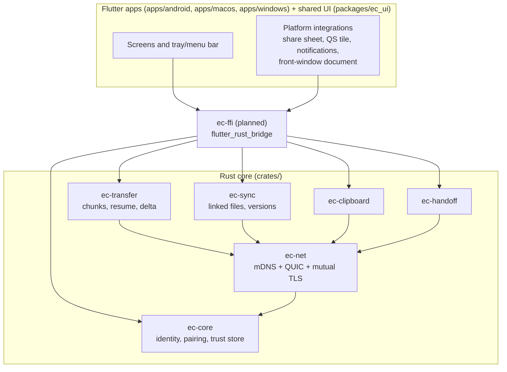
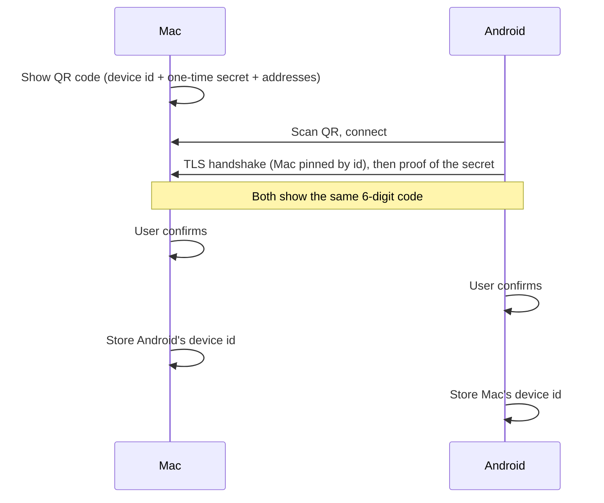

# Architecture

This document describes how ECOnnector is put together. It is updated as each
phase lands; sections marked *planned* describe intent, not existing code.

## Goals

1. **Fast.** Wi-Fi transfers should approach the link's real throughput, and a USB cable
   should make an active transfer faster without restarting it.
2. **Secure by default.** Only devices you paired can talk to each other. All traffic is
   encrypted and authenticated. No cloud service is involved.
3. **Integrated.** It should feel like part of the operating system: a menu bar or tray
   icon on desktop, the share sheet, a Quick Settings tile and notifications on Android.
4. **Simple.** Pair once, then it just works.

Non-goals for v1: connecting over the internet, iOS support, page-level handoff inside
third-party apps.

## Components

Repository layout and module rules: [DEVELOPMENT.md](DEVELOPMENT.md).



| Crate | Responsibility |
|---|---|
| `ec-core` | Long-term device key (Ed25519), device name, pairing handshake, trust store of paired devices. |
| `ec-net` | mDNS advertisement and discovery, QUIC connections (quinn) with mutual TLS 1.3 using pinned certificates derived from device keys, path changes. |
| `ec-transfer` | Splits files into chunks, sends them over parallel streams, verifies BLAKE3 hashes, resumes from the missing chunks, sends only changed chunks of edited files. |
| `ec-sync` | Linked files: a link id shared by all devices, version vectors, the journal and change log, file watching, conflicts. |
| `ec-runtime` | A running device: identity, trust store, node, presence, remembered addresses, one connection per paired device, pairing, sending and receiving. Used by the apps and tested on its own. |
| `ec-ffi` | flutter_rust_bridge API over `ec-runtime` for the Flutter apps (crate `ec_ffi`). |
| `ec-clipboard` | Clipboard and link messages. |
| `ec-cli` | The `ec` command line tool: pairing, discovery and connection checks without the app. |
| `ec-handoff` | Broadcasts the "active item" (a file, or a URL with scroll position) so another device can offer to continue it. |

## Key flows

### Pairing

Implemented in phase 1. The exact messages are in [PROTOCOL.md](PROTOCOL.md).



### Fast transfer and cable boost

Implemented in phase 2 (`ec-transfer`). Files are split into chunks with BLAKE3 hashes
and sent over parallel QUIC streams. All needed chunks sit in one queue, and every
network path to the receiver (one QUIC connection each) runs workers that take from it.
When a new network interface appears (USB tethering on Android, a Thunderbolt or USB-C
bridge between computers), the sender looks the receiver up again and opens a
connection over the new address. That path starts taking chunks immediately, and
because a faster path acknowledges sooner, it takes more of them. Nothing restarts.

QUIC connection migration was considered and not used: QUIC only lets the client move
its own address, while a cable gives the receiver a new address too. A second
connection works in every case and also allows using Wi-Fi and the cable together.

If the connection carrying the control stream fails, the sender starts a new attempt;
the receiver hashes its partial files and asks only for what is missing. Details:
[PROTOCOL.md](PROTOCOL.md#file-transfer-kinds-1-and-2).

### Linked files

Implemented in phase 4 (`ec-sync`). Design:
[superpowers/specs/2026-10-19-linked-files-design.md](superpowers/specs/2026-10-19-linked-files-design.md).

A linked file has the same link id on every device and a **version vector**: each device
numbers its own changes. A version that includes all changes of another follows it;
two versions that each have changes the other lacks were made independently, which is a
conflict. Clocks are never compared between devices.

```mermaid
sequenceDiagram
    participant M as Mac
    participant T as Tablet
    Note over M: saved; quiet for 2 s; size or time changed → hash
    M->>M: Mac's counter + 1, log entry
    M->>T: sync: Changed { id, version, hashes }
    Note over T: version follows mine → update
    T->>M: sync: Reply { want: true }
    M->>T: transfer with Target { id }: only chunks the tablet lacks
    Note over T: unchanged since last look? replace in one step : keep as conflict
```

The **watcher** hashes a file only when its size or modification time changed, and only
after two quiet seconds. File system events (FSEvents, inotify) say when to look; a
periodic check of size and time (every 5 s in the Android app, 60 s elsewhere) covers
folders where events are unreliable. A file that is no longer at its path is looked for
by its identity on the volume: found, it was moved and syncing continues; gone with a
delete event, it was deleted and this device leaves the link; otherwise it is *missing*
and the link is kept.

On the receiving device linked files go to `<receive folder>/Linked/<date>/`. A received
version is placed by the linked files service instead of the usual non-colliding rename:
it replaces the file if the file is unchanged since the device last looked, and
otherwise waits as a conflict, so a local edit is never overwritten. Chunks the local
copy already has, at any index, are copied from it rather than received. No old
versions are kept; a conflicting version waits until the user chooses, then goes to the
Trash. A device linked with several others passes a received version on to the rest.

## Platform constraints

- **macOS has no Wi-Fi Direct**, so Mac ↔ Android without a router needs a phone hotspot
  or a cable.
- **Android 10+ blocks background clipboard reads.** Desktop → phone clipboard is
  automatic; phone → desktop uses a notification action, the Quick Settings tile or the
  share sheet.
- **Handoff** can only see what the OS exposes: the front window's document on macOS
  (Accessibility API), the URL and scroll position through the browser extension.
