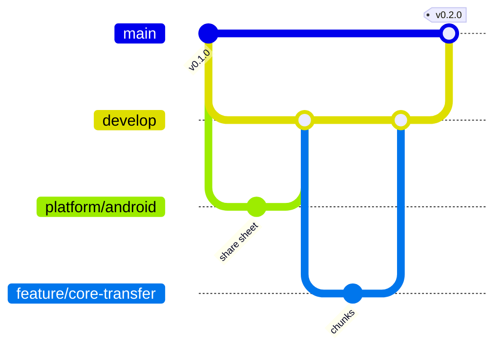

# Development

How the repository is organised, how to set up each platform's environment, and how
changes flow from a branch to a release.

## Layout

```
crates/              Rust core, shared by every platform (Cargo workspace)
  ec-core            identity, pairing crypto, trust store
  ec-net             discovery, QUIC + TLS, pairing protocol
  ec-transfer …      later phases
  ec-cli             the `ec` command line tool
packages/
  ec_ui              shared Flutter UI (no platform code)
apps/                one Flutter project per platform, each with its own native code
  android/
  macos/
  windows/
tools/               scripts: local checks, release signing setup
.github/workflows/   one workflow per area (see below)
```

`pubspec.yaml` at the root is a [Dart workspace](https://dart.dev/tools/pub/workspaces):
one `flutter pub get` at the root resolves `packages/` and every app together, with a
single `pubspec.lock`.

### Module rules

- **Dependencies point inwards.** Apps depend on `ec_ui` and (from phase 3) on the Rust
  core through a bridge package. `ec_ui` never depends on an app. Crates depend on
  `ec-core`, never the other way round.
- **Platform code stays in its app.** A Kotlin, Swift or C++ change touches exactly one
  folder in `apps/`.
- **One crate, one responsibility.** A new capability (for example clipboard) gets its
  own crate and, if it has UI, its own folder under `packages/ec_ui/lib/src/`.

## Environments

Each area can be set up and checked on its own. `tools/check.sh <area>` runs the same
checks as CI for that area.

### Core

- [Rust](https://rustup.rs) stable (pinned by `rust-toolchain.toml`)
- Optional: `cargo install cargo-deny` for the dependency audit

```sh
tools/check.sh core
```

### Fuzzing

Parsers of untrusted input have fuzz targets in `fuzz/` (needs a nightly toolchain):

```sh
rustup toolchain install nightly
cargo install cargo-fuzz
cd fuzz && cargo +nightly fuzz run rel_path -- -max_total_time=60
```

Targets: `invite`, `control_message`, `rel_path`. Add one for every new parser.

### Android

- Flutter stable (CI uses the version in `.github/workflows/android.yml`)
- Android Studio (SDK, NDK, and its bundled JDK 17)

```sh
tools/check.sh android
cd apps/android && flutter run
```

Release builds are signed in CI. To set up signing once for the repository, the
maintainer runs `tools/android/setup-release-signing.sh`. It keeps the key in
`~/.ecosystem-connector-release/`, outside the repository, and uploads it as secrets of
the `release` environment, which only `v*` tags can use. Local release builds without
those variables are signed with the debug key.

### macOS

- Flutter stable
- Full Xcode (not only the command line tools), then `sudo xcodebuild -runFirstLaunch`

```sh
tools/check.sh macos
cd apps/macos && flutter run -d macos
```

### Windows

- Flutter stable
- Visual Studio 2022 with the "Desktop development with C++" workload

```powershell
cd apps/windows; flutter run -d windows
```

## Branches



| Branch | Purpose |
|---|---|
| `main` | Released code only. Every release is a tag on `main`. |
| `develop` | Integration branch; the next release is assembled here. |
| `platform/android`, `platform/macos`, `platform/windows` | Long-lived work on one platform's app (`apps/<platform>/`). Merged into `develop` regularly, and updated from `develop` so they do not drift. |
| `feature/<area>-<topic>` | Short-lived work, for example `feature/core-transfer` or `feature/android-qs-tile`. Branch from `develop` (or from a platform branch), merge back with a pull request. |
| `fix/<topic>` | Bug fixes. Urgent fixes for a release branch from `main` and are merged into both `main` and `develop`. |

Pull requests are labelled automatically by area (`platform: android`, `area: core`, …),
and each area's workflow only runs when its files change.

## Releases

1. Merge `develop` into `main`.
2. Tag: `git tag -a v0.2.0 -m "v0.2.0" && git push origin v0.2.0`.
3. The Release workflow builds the Android APKs (signed), the macOS and Windows apps
   and the `ec` CLI, writes `SHA256SUMS.txt`, attests build provenance and publishes the
   GitHub release. Tags with a suffix such as `v0.2.0-alpha.1` are marked as pre-releases.

Versions follow [Semantic Versioning](https://semver.org). The app version comes from
the tag, and the build number from the workflow run number, so every release can update
the previous one on Android.
