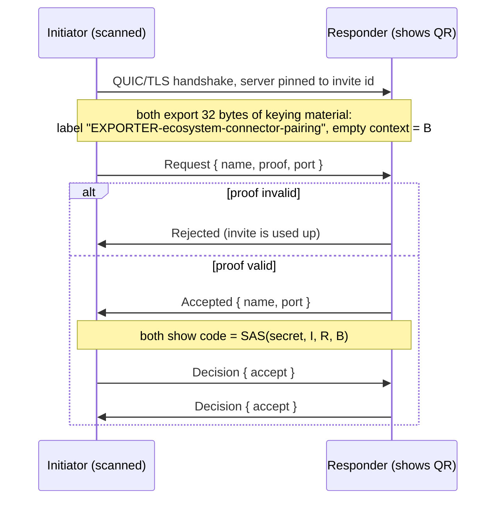
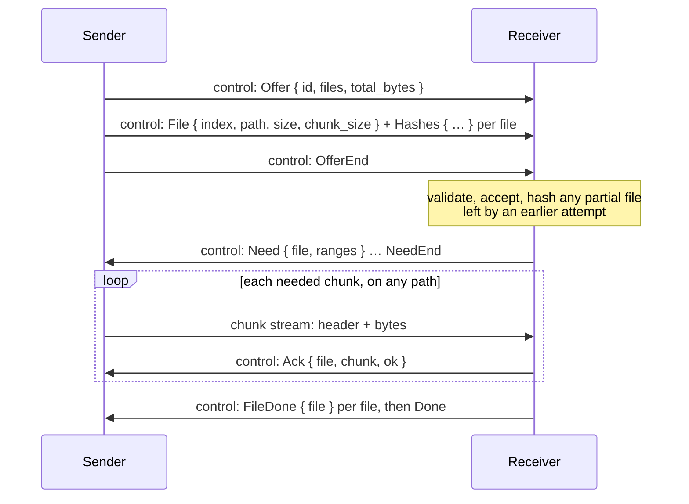

# Protocol

Wire protocol between ECOnnector devices, version 1. Code: `crates/ec-net`.

## Transport

- QUIC (RFC 9000) over UDP, TLS 1.3 only, Ed25519 certificates, mutual authentication.
- Server name in the handshake is always `ecosystem-connector`. It is not used for trust.
- Trust decision: the BLAKE3 hash of the peer's certificate (DER) must equal the expected
  `DeviceId`. No certificate chains are accepted.
- ALPN selects the protocol: `ec/1` for regular sessions, `ec-pair/1` for pairing.
- Keep-alive every 5 s, idle timeout 20 s.

## Framing

Control messages are sent on bidirectional streams as frames:

```
+----------------------+---------------------------+
| length: u32, big end | body: postcard, ≤ 64 KiB  |
+----------------------+---------------------------+
```

A frame longer than 64 KiB is a protocol error and is rejected before allocating.
Trailing bytes after a decoded body are rejected.

## Discovery

DNS-SD service `_ecconnect._udp.local.`, instance `ec-<first 16 hex chars of id>`, with
TXT records:

| Key | Value |
|---|---|
| `id` | Device id, 64 hex characters |
| `name` | Device name |
| `v` | Protocol version, `1` |

The port is the node's QUIC port. Announcements are not authenticated; see
[THREAT_MODEL.md](THREAT_MODEL.md).

## Pairing (`ec-pair/1`)

The responder shows an invite (QR code or link):

```
ecpair:1?id=<responder id hex>&s=<secret hex, 32 bytes>&a=<ip:port>,<ip:port>
```

Unknown query keys are ignored, duplicate keys are rejected, at most 8 addresses.



Definitions, with `I` and `R` the 32-byte device ids and `B` the exported keying material:

```
proof = BLAKE3-keyed(secret, "ecosystem-connector pairing proof v1" ‖ I ‖ R ‖ len(B) as u64 LE ‖ B)
h     = BLAKE3-keyed(secret, "ecosystem-connector pairing code v1"  ‖ I ‖ R ‖ len(B) as u64 LE ‖ B)
code  = (first 8 bytes of h as u64 LE) mod 1 000 000, shown as "ddd ddd"
```

`port` is the sender's regular node port. Each side stores the other's address (the
IP the pairing connection came from, with that port) so it can find the device again
on networks where mDNS does not work.

The proof is compared in constant time. Pairing succeeds only if both decisions are
`accept`. Then each side stores the other's id in its trust store.

Timeouts: 120 s for a device to connect, 10 s per protocol step, 90 s for each user decision.

## Finding paired devices

Devices listen on UDP port **47820** by default (another free port if it is taken).
They are found in two ways:

1. **mDNS** (above) on networks that deliver multicast.
2. **Remembered addresses.** Every few seconds a device connects to each paired device
   it has no connection with, using the addresses mDNS reported, the address of the
   last connection from that device, or the address learned during pairing.

A device keeps **one connection per paired device**, whichever side opened it, and both
sides answer streams on it. So if only one side can accept connections (a VPN, a
firewall or NAT in front of the other), files still flow both ways.

## Stream kinds (`ec/1`)

Only devices in each other's trust store complete the handshake. The first byte of
every stream on a regular connection names the service it belongs to:

| Kind | Stream | Service |
|---|---|---|
| `0` | bidirectional | Session: hello and ping |
| `1` | bidirectional | Transfer control |
| `2` | unidirectional | Transfer chunk |

A stream of an unknown kind is stopped.

## Sessions (kind 0)

The opener sends `Hello { name }` and the other side answers with its own `Hello`.
After that the stream carries:

| Message | Meaning |
|---|---|
| `Ping { nonce: u64 }` | Liveness and round-trip time |
| `Pong { nonce: u64 }` | Answer with the same nonce |

## File transfer (kinds 1 and 2)

Code: `crates/ec-transfer`.

Files are cut into chunks (4 MiB, doubled for files over 32 GiB so a file never has
more than 8192 chunks). Each chunk has a BLAKE3 hash, computed by the sender before the
offer. Each transfer has a random 16-byte id.



### Chunk streams

A unidirectional stream of kind `2` carries exactly one chunk:

```
+-------------+--------------+---------------+-------------------------+
| id: 16 B    | file: u32 LE | chunk: u32 LE | chunk bytes (exact len) |
+-------------+--------------+---------------+-------------------------+
```

The receiver checks that the transfer exists and belongs to the connection's device,
that the indices are in range, that the stream holds exactly the chunk's length, and
that the BLAKE3 hash matches. Only then is the chunk written and acknowledged with
`ok = true`. A chunk that fails is acknowledged with `ok = false` and sent again.

### Several paths at once

Chunk streams may arrive on **any** connection from the same device, not only the one
carrying the control stream. The sender keeps one queue of needed chunks and runs a few
workers per connection; each worker takes the next chunk and waits for its `Ack`. A
faster path (a USB cable next to Wi-Fi) acknowledges sooner and so takes more chunks.
When a path fails, its unacknowledged chunks return to the queue. The sender watches the
local network interfaces and, when they change, looks the device up again and opens a
connection over any new address.

### Resume

The receiver keeps unfinished files in `.ecosystem-connector-partial/` inside the receive
folder, named by a hash of the sending device, path, size and chunk hashes. When the
same file is offered again, the receiver hashes the partial file and only lists the
chunks that do not match in its `Need` messages. If the control connection fails, the
sender starts a new attempt (up to 5, with fresh addresses) and the same mechanism
resumes it.

### Finishing

When every chunk is written, the receiver flushes each file to disk and renames it into
place. It never overwrites: an existing name gets ` (1)`, ` (2)`, … before the extension.

### Limits enforced by the receiver

| What | Limit |
|---|---|
| Files per transfer | 100 000 |
| Chunks per file | 8 192 |
| Chunk size | 64 KiB – 64 MiB |
| Hashes per message | 1 024 |
| Transfers at once | 8 |
| Chunk data held in memory | 256 MiB across all transfers |

Received paths must have 1–32 components, at most 255 bytes each and 1024 in total. A
component may not be empty, `.` or `..`; may not contain `/ \ : * ? " < > |`, control
characters or bidirectional overrides; may not end with a dot or space; and may not be
a reserved Windows device name (`CON`, `NUL`, `COM1`, …). Folders are created one by
one and must not be symbolic links.
