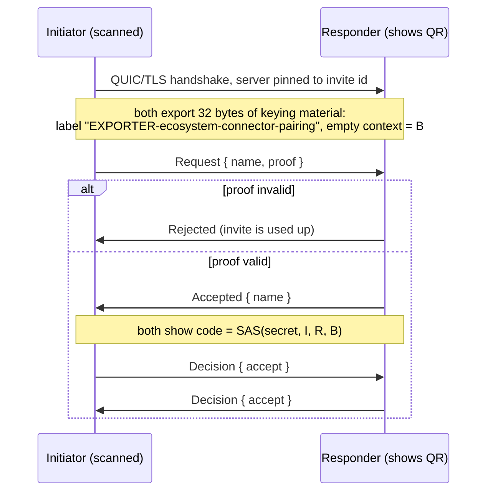

# Protocol

Wire protocol between Ecosystem Connector devices, version 1. Code: `crates/ec-net`.

## Transport

- QUIC (RFC 9000) over UDP, TLS 1.3 only, Ed25519 certificates, mutual authentication.
- Server name in the handshake is always `ecosystem-connector`. It is not used for trust.
- Trust decision: the BLAKE3 hash of the peer's certificate (DER) must equal the expected
  `DeviceId`. No certificate chains are accepted.
- ALPN selects the protocol: `ec/1` for regular sessions, `ec-pair/1` for pairing.
- Keep-alive every 5 s, idle timeout 20 s.

## Framing

Control messages are sent on bidirectional streams as frames:

```
+----------------------+---------------------------+
| length: u32, big end | body: postcard, ≤ 64 KiB  |
+----------------------+---------------------------+
```

A frame longer than 64 KiB is a protocol error and is rejected before allocating.
Trailing bytes after a decoded body are rejected.

## Discovery

DNS-SD service `_ecconnect._udp.local.`, instance `ec-<first 16 hex chars of id>`, with
TXT records:

| Key | Value |
|---|---|
| `id` | Device id, 64 hex characters |
| `name` | Device name |
| `v` | Protocol version, `1` |

The port is the node's QUIC port. Announcements are not authenticated; see
[THREAT_MODEL.md](THREAT_MODEL.md).

## Pairing (`ec-pair/1`)

The responder shows an invite (QR code or link):

```
ecpair:1?id=<responder id hex>&s=<secret hex, 32 bytes>&a=<ip:port>,<ip:port>
```

Unknown query keys are ignored, duplicate keys are rejected, at most 8 addresses.



Definitions, with `I` and `R` the 32-byte device ids and `B` the exported keying material:

```
proof = BLAKE3-keyed(secret, "ecosystem-connector pairing proof v1" ‖ I ‖ R ‖ len(B) as u64 LE ‖ B)
h     = BLAKE3-keyed(secret, "ecosystem-connector pairing code v1"  ‖ I ‖ R ‖ len(B) as u64 LE ‖ B)
code  = (first 8 bytes of h as u64 LE) mod 1 000 000, shown as "ddd ddd"
```

The proof is compared in constant time. Pairing succeeds only if both decisions are
`accept`. Then each side stores the other's id in its trust store.

Timeouts: 120 s for a device to connect, 10 s per protocol step, 90 s for each user decision.

## Sessions (`ec/1`)

Only devices in each other's trust store complete the handshake. On a new bidirectional
stream the opener sends `Hello { name }` and the other side answers with its own `Hello`.
After that the stream carries:

| Message | Meaning |
|---|---|
| `Ping { nonce: u64 }` | Liveness and round-trip time |
| `Pong { nonce: u64 }` | Answer with the same nonce |

File transfer, clipboard and handoff messages are added in later phases.
